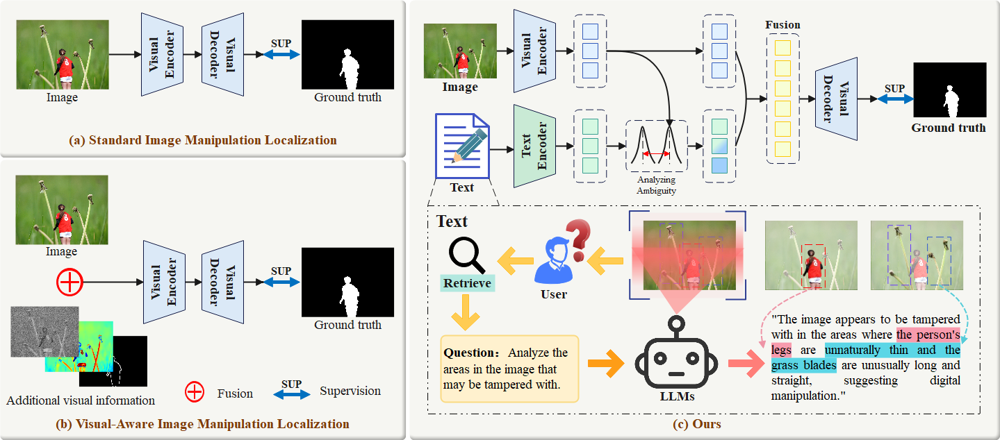

# <center> Bridging Semantic Logic Gaps: A Cognition Inspired Multimodal Boundary Preserving Network for Image Manipulation Localization

## 🚀 Motivation



Comparison with mainstream IML methods. We use LLMs to analyze potential tampered regions in images and generate prompt-based textual information to enhance visual features. In addition, the text features are weighted by quantifying the ambiguity of images and texts, which solves the inaccurate localization caused by the hallucination problem of LLMs.

## 🎮 Getting Started

### 1. Install Environment

Run these commands from the repository root on a Linux machine with a CUDA-capable GPU.

```bash
conda env create -f CMB-Net.yml -n CMB-Net
conda activate CMB-Net
```

### 2. Prepare Datasets and Pretrained Weights

- CASIAv2.0 [Download](https://github.com/SunnyHaze/IML-Dataset-Corrections)
- CASIAv1.0 [Download](https://github.com/SunnyHaze/IML-Dataset-Corrections)
- Columbia [Download](https://www.ee.columbia.edu/ln/dvmm/downloads/authsplcuncmp/)
- Coverage [Download](https://github.com/wenbihan/coverage?tab=readme-ov-file)
- NIST16 [Download](https://mfc.nist.gov/users/sign_in)

Put training images in `train/Tp/`, ground-truth masks in `train/Gt/`, edge targets in `train/Edge/`, and captions in `train/Text/`. For each test dataset, put images, ground-truth masks, and captions in `test/<dataset>/Tp/`, `test/<dataset>/Gt/`, and `test/<dataset>/Text/`, respectively. Use `C1` for CASIAv1.0 and `NC16` for NIST16. Keep the image and ground-truth files paired in sorted filename order and use the dataset-specific ground-truth filenames expected by `eval_mult.py`.

Provide one plain-text caption per image, named after the part of the image filename before the first dot (for example, `sample.jpg` uses `sample.txt`). The commands below use `Text` for Qwen captions. To use GPT captions, put them in the corresponding `GPT_Text` directories and pass `--text_dir GPT_Text` to both training and inference. Use a checkpoint trained with the corresponding captions when evaluating either variant.

For training and inference, provide a local directory containing the BERT model and tokenizer, and a local `pvt_v2_b2.pth` file with the ImageNet-pretrained PVTv2-B2 weights. Replace the example paths with the locations on your machine. [BERT base (uncased)](https://huggingface.co/google-bert/bert-base-uncased) · [PVTv2 model zoo](https://github.com/whai362/PVT#model-zoo)

### 3. Train the Net

```bash
python etrain.py
```

### 4. Run Inference and Evaluate

Generate predicted masks for the four test datasets. Replace `--pth_path` with the checkpoint you want to evaluate.

```bash
python etest.py 
```

Inference saves masks under `result/<dataset>/`. Evaluate the predictions against the ground-truth masks to report AUC, F1, and IoU. The evaluation script writes the results to `result/Eval_log.txt`.

```bash
python eval_mult.py \
  --pred_root result \
  --test_root /path/to/IML-DS/test \
  --datasets C1 Coverage Columbia NC16
```

### 5. Experimental Results

The experimental results (`tifs-result`) are available on [Baidu Netdisk](https://pan.baidu.com/s/1CXiybOS7SnflHwqcFD4cSA?pwd=2vuz).

**Extraction code:** `2vuz`

### 6. Citation

```bibtex
@article{li2026bridging,
  title={Bridging semantic logic gaps: A cognition inspired multimodal boundary preserving network for image manipulation localization},
  author={Li, Songlin and Guo, Zhiqing and Li, Yuanman and Li, Zeyu and Diao, Yunfeng and Yang, Gaobo and Wang, Liejun},
  journal={IEEE Transactions on Information Forensics and Security},
  year={2026},
  publisher={IEEE}
}
```
